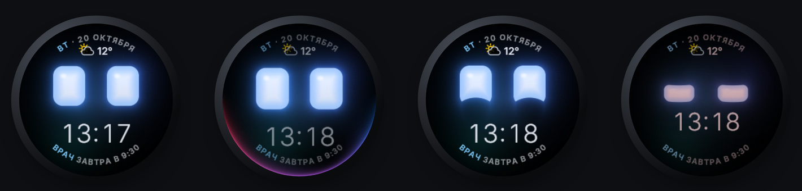
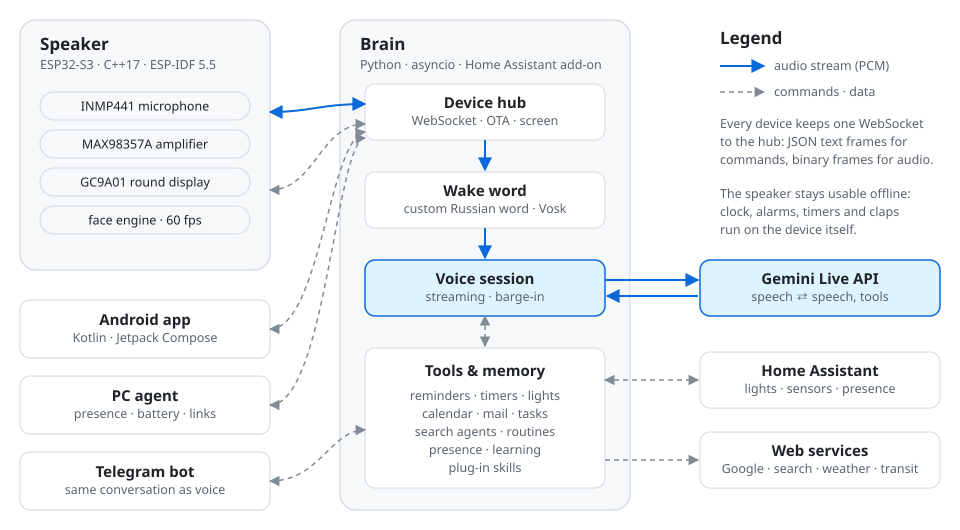

<div align="center">

# ESP32 Voice Assistant

**A home voice assistant built from scratch: custom ESP32-S3 firmware, a Python brain on Gemini Live,
and an Android companion app. Home Assistant is just a bridge to the smart home.**

[](https://github.com/GefryV3/esp32-voice-assistant/actions/workflows/server.yml)
[](https://github.com/GefryV3/esp32-voice-assistant/actions/workflows/firmware.yml)
[](https://github.com/GefryV3/esp32-voice-assistant/actions/workflows/android.yml)
[](LICENSE)


**English** · [Русский](README.ru.md)

<br>



<sub>The 1.28″ round display rendered by the firmware: idle with clock and weather · listening · happy · asleep</sub>

</div>

---

## Why

The first version of this assistant lived inside Home Assistant: ESPHome YAML, a custom integration and a pile
of YAML automations. It worked, but the logic was smeared across templates and painful to debug or test.

This repository is the rewrite: **all logic is ordinary code with tests**. The speaker runs its own C++ firmware,
the "brain" is a Python asyncio server, and Home Assistant only does what it is good at: lights, sensors,
presence, weather and calendars.

The assistant speaks Russian, is named «Мага», and has a deliberately sarcastic character.

## Highlights

- 🎙️ **Real-time voice conversation** through the Gemini Live API: audio streams straight from the speaker's
  microphone, the first sound of the reply comes back in 0.3–1 s, and you can interrupt it mid-sentence (barge-in).
- 👀 **An expressive round face** at up to 60 fps, rendered on both ESP32-S3 cores: spring-animated eyes, a clock,
  weather, glow while talking, emotions, timers, games and phone cards.
- 🗣️ **Custom Russian wake word** «Мага» (Vosk with a fixed grammar), with openWakeWord "Hey Jarvis" as a fallback.
- 🏠 **Smart home via Home Assistant's WebSocket API**: lights by name or room, colours, effects, sensors, presence.
  If HA is down, the assistant still talks; it just can't control the house.
- 🧠 **Memory and tools**: facts, reminders, timers, Google Calendar / Gmail / Tasks, web search agents,
  morning briefings, a school-schedule alarm, live public-transport departures, "take an umbrella" warnings.
- 💬 **One conversation across voice and Telegram**: what you say to the speaker is visible in the chat, and vice versa.
- 🌙 **Lives in a bedroom**: night mode, quieter and shorter replies at night, "don't listen for an hour",
  and it only reacts when you are actually in the room (PC activity, phone, HA presence, optional BLE beacon).
- 📱 **Android companion app** (Material You / Material 3 Expressive): notifications, calls, now playing, alarms,
  "find my phone", earbud battery and all speaker settings.
- 🧩 **Skills platform**: plug-in skills, plus a flow where the assistant proposes a new skill, you approve it in
  Telegram, and Claude Code implements it on the laptop.
- 🔁 **OTA updates with rollback**: the firmware confirms itself only after it reaches the server.
- ✅ **421 server tests** and CI for the server, the firmware and the Android app.

## Architecture

<picture>
  <source media="(prefers-color-scheme: dark)" srcset="docs/images/architecture-dark.svg">
  
</picture>

**Design principles**

1. **All logic lives in ordinary code.** No YAML automations or Jinja templates; schedules, reactions and dialogue
   are Python with tests. There is no custom code inside Home Assistant.
2. **The speaker is thin but alive.** The firmware hears, plays audio and draws the face; the server decides what to
   say and show. Animations are computed on the device; the server only says "roll the dice, it's a 5".
3. **One channel.** The speaker is a WebSocket client: text frames carry versioned JSON commands, binary frames carry
   audio. See [docs/protocol.md](docs/protocol.md).
4. **Home Assistant is a bridge, not the brain.** The server talks to HA over its WebSocket API with a long-lived token.
5. **Every stage ends with something you can see or hear.** See [docs/roadmap.md](docs/roadmap.md).

More detail: [docs/architecture.md](docs/architecture.md).

## Hardware

| Part | Model | Connection |
|---|---|---|
| Board | Lolin S3 Mini (ESP32-S3FH4R2) | 4 MB flash, 2 MB quad PSRAM, native USB-Serial-JTAG |
| Display | GC9A01, 1.28″ round IPS, 240×240 | SPI: CLK 12, MOSI 13, CS 16, DC 15, RST 14 |
| Microphone | INMP441 (I2S MEMS) | I2S in: SCK 9, WS 10, SD 11, L/R → GND |
| Amplifier | MAX98357A + speaker | I2S out: BCLK 4, LRC 44, DIN 5 |

The two I2S peripherals are independent, so recording and playback run at the same time. Notes on Wi-Fi noise in the
microphone, PSRAM, and the flash layout (byte-compatible with ESPHome, so OTA works in both directions) are in
[docs/hardware.md](docs/hardware.md).

## Repository layout

```text
firmware/   Speaker firmware: C++17 on ESP-IDF 5.5 (display, face engine, audio, Wi-Fi, WebSocket, OTA)
server/     The brain: Python 3.12+ asyncio package `jarvis`, tests, tools, Home Assistant add-on
phone/      Android companion app «Колонка»: Kotlin, Jetpack Compose, Material 3 Expressive
pc/         Small Windows agent: "am I at the computer", laptop battery, links to the phone
design/     Interactive HTML mockup of the round screen; the firmware renders this design
docs/       Architecture, protocol, hardware, roadmap, per-feature change notes
legacy/     The original ESPHome + Home Assistant version, kept for reference (not built)
```

## Getting started

<details>
<summary><b>Server</b> (Python 3.12+)</summary>

```bash
cd server
python -m venv .venv
.venv/bin/pip install -e ".[dev]"      # Windows: .venv\Scripts\pip install -e .[dev]
cp .env.example .env                   # set JARVIS_DEVICE_TOKEN, GEMINI_API_KEY, optional HA / Telegram / Google keys
.venv/bin/python -m jarvis
```

No hardware? Run a fake speaker against the server: `python tools/fake_device.py`.
Tests: `pytest` (about 30 s).

In production the server runs as a local **Home Assistant add-on** (`server/addon`, Docker on `python:3.13-alpine`),
deployed with `tools/deploy_addon.py` and updated with `tools/ha_admin.py`.

</details>

<details>
<summary><b>Firmware</b> (ESP-IDF 5.5)</summary>

```powershell
cd firmware
copy main\secrets.h.example main\secrets.h   # Wi-Fi, server URL, device token
.\idf.ps1 build
.\idf.ps1 -p COM3 flash
```

`idf.ps1` is a thin Windows wrapper around `idf.py`; on Linux or macOS use `idf.py build` directly.
After the first USB flash, updates go over the air: `python server/tools/send.py ota`.
Details: [firmware/README.md](firmware/README.md).

</details>

<details>
<summary><b>Android app</b> (JDK 17, Android SDK 35)</summary>

```bash
gradle -p phone assembleDebug
```

The server address and token are baked in from `server/.env` at build time and can be changed in the app.
Details: [phone/README.md](phone/README.md).

</details>

## Documentation

| Document | What's inside |
|---|---|
| [architecture.md](docs/architecture.md) | How everything fits together, firmware and server modules, FreeRTOS task layout |
| [protocol.md](docs/protocol.md) | The WebSocket protocol between speaker, server, phone and PC |
| [hardware.md](docs/hardware.md) | Parts, pins and hardware pitfalls |
| [roadmap.md](docs/roadmap.md) | Stages and what is already done |
| [use-cases.md](docs/use-cases.md) | What the assistant is for (and what it deliberately doesn't do) |
| [skills.md](docs/skills.md) | Writing plug-in skills |
| [changes/](docs/changes) | Notes for every feature branch, including what to verify live |

Most documents are written in Russian.

## Status

The project is in active development and runs daily at home. Current versions: **server 0.13.1**, **firmware 0.6.0**.
Next up: training a wake-word model that runs on the speaker itself (microWakeWord / TFLite Micro), so the
microphone stream only leaves the device after the wake word.

## Acknowledgements

- [ESP-IDF](https://github.com/espressif/esp-idf) and the Espressif component registry
- [Gemini Live API](https://ai.google.dev/gemini-api/docs/live) for real-time voice
- [Vosk](https://alphacephei.com/vosk/) and [openWakeWord](https://github.com/dscripka/openWakeWord) for wake words
- [Inter](https://rsms.me/inter/) typeface by Rasmus Andersson (SIL Open Font License 1.1)
- Large parts of the code were pair-programmed with [Claude Code](https://claude.com/claude-code)

## License

[MIT](LICENSE). The bundled Inter font is licensed separately under the
[SIL Open Font License 1.1](phone/FONT-LICENSE-OFL.txt).
