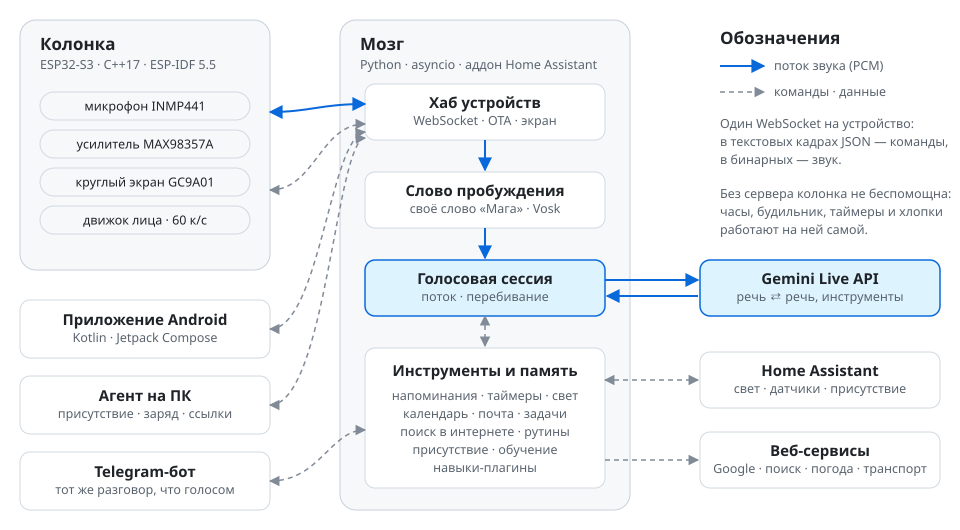

<div align="center">

# ESP32 Voice Assistant

**Домашний голосовой ассистент с нуля: своя прошивка для ESP32-S3, «мозг» на Python с Gemini Live
и приложение для Android. Home Assistant — только посредник для умного дома.**

[](https://github.com/GefryV3/esp32-voice-assistant/actions/workflows/server.yml)
[](https://github.com/GefryV3/esp32-voice-assistant/actions/workflows/firmware.yml)
[](https://github.com/GefryV3/esp32-voice-assistant/actions/workflows/android.yml)
[](LICENSE)

[English](README.md) · **Русский**

<br>


<sub>Круглый экран 1.28″, который рисует прошивка: покой с часами и погодой · слушает · радость · сон</sub>

</div>

---

## Зачем

Первая версия ассистента жила внутри Home Assistant: ESPHome YAML, своя интеграция и куча YAML-автоматизаций.
Работало, но логика была размазана по шаблонам, отлаживать и тестировать это было больно.

Здесь всё переписано: **вся логика — обычный код с тестами**. На колонке своя прошивка на C++, «мозг» — сервер
на Python (asyncio), а Home Assistant делает только то, что умеет лучше всех: свет, датчики, «кто дома», погода,
календари.

Ассистент говорит по-русски, зовут его «Мага», характер у него нарочно язвительный.

## Что умеет

- 🎙️ **Живой разговор** через Gemini Live API: звук идёт прямо с микрофона колонки, первый звук ответа через
  0.3–1 с, перебить можно на полуслове.
- 👀 **Выразительное круглое лицо** до 60 кадров в секунду на двух ядрах ESP32-S3: глаза на пружинах, часы, погода,
  сияние в разговоре, эмоции, таймеры, игры, карточки с телефона.
- 🗣️ **Своё русское слово пробуждения** «Мага» (Vosk с грамматикой), запасное — openWakeWord «Hey Jarvis».
- 🏠 **Умный дом через WebSocket API Home Assistant**: свет по имени или комнате, цвета, эффекты, датчики, присутствие.
  Если HA недоступен, ассистент всё равно разговаривает, просто не управляет домом.
- 🧠 **Память и инструменты**: факты, напоминания, таймеры, Google Календарь / Почта / Задачи, фоновый поиск в
  интернете, утренний брифинг, будильник по школьному расписанию, отправления автобуса, «возьми зонт».
- 💬 **Один разговор на голос и Telegram**: сказанное колонке видно в чате, и наоборот.
- 🌙 **Живёт в спальне**: ночной режим, ночью тише и короче, «не слушай час», и реагирует, только когда ты рядом
  (активность компьютера, телефон, присутствие в HA, по желанию BLE-маячок).
- 📱 **Приложение «Колонка»** (Material You / Material 3 Expressive): уведомления, звонки, плеер, будильник,
  «где мой телефон», заряд наушников и все настройки колонки.
- 🧩 **Навыки**: плагины, а ещё ассистент может сам предложить новый навык; ты одобряешь его в Telegram, и Claude Code
  пишет его на ноутбуке.
- 🔁 **Обновление по воздуху с откатом**: прошивка подтверждает себя, только когда связалась с сервером.
- ✅ **421 тест сервера** и автоматические проверки (CI) для сервера, прошивки и приложения.

## Как устроено

<picture>
  <source media="(prefers-color-scheme: dark)" srcset="docs/images/architecture-dark-ru.svg">
  
</picture>

**Принципы**

1. **Вся логика — в обычном коде.** Никаких YAML-автоматизаций и шаблонов Jinja: расписание, реакции и диалог —
   это Python с тестами. Внутри Home Assistant нашего кода нет.
2. **Колонка «тонкая», но живая.** Прошивка слышит, играет звук и рисует лицо; что сказать и показать, решает сервер.
   Анимации считаются на самой колонке: сервер шлёт только «покажи кубик, выпало 5».
3. **Один канал связи.** Колонка — клиент WebSocket: текстовые кадры — команды в JSON с версией протокола,
   бинарные — звук. См. [docs/protocol.md](docs/protocol.md).
4. **HA — посредник, а не мозг.** Сервер ходит в HA через WebSocket API с долгоживущим токеном.
5. **Каждый этап заканчивается тем, что можно увидеть или услышать.** См. [docs/roadmap.md](docs/roadmap.md).

Подробнее: [docs/architecture.md](docs/architecture.md).

## Железо

| Узел | Модель | Подключение |
|---|---|---|
| Плата | Lolin S3 Mini (ESP32-S3FH4R2) | 4 МБ flash, 2 МБ quad-PSRAM, встроенный USB-Serial-JTAG |
| Экран | GC9A01, круглый IPS 1.28″, 240×240 | SPI: CLK 12, MOSI 13, CS 16, DC 15, RST 14 |
| Микрофон | INMP441 (I2S MEMS) | I2S вход: SCK 9, WS 10, SD 11, L/R → GND |
| Усилитель | MAX98357A + динамик | I2S выход: BCLK 4, LRC 44, DIN 5 |

Два I2S независимы, поэтому запись и воспроизведение идут одновременно. Про помехи Wi-Fi в микрофоне, PSRAM и
разметку flash (совпадает с ESPHome байт в байт, поэтому по воздуху можно перейти в обе стороны) —
в [docs/hardware.md](docs/hardware.md).

## Что где лежит

```text
firmware/   прошивка колонки: C++17 на ESP-IDF 5.5 (экран, движок лица, звук, Wi-Fi, WebSocket, OTA)
server/     мозг: пакет `jarvis` на Python 3.12+ (asyncio), тесты, утилиты, аддон Home Assistant
phone/      приложение «Колонка»: Kotlin, Jetpack Compose, Material 3 Expressive
pc/         маленький агент для Windows: «сижу ли я за компьютером», заряд ноутбука, ссылки на телефон
design/     интерактивный HTML-макет круглого экрана; прошивка рисует именно его
docs/       архитектура, протокол, железо, этапы, заметки по каждой доработке
legacy/     первая версия на ESPHome + Home Assistant, только для справки (не собирается)
```

## Как запустить

<details>
<summary><b>Сервер</b> (Python 3.12+)</summary>

```powershell
cd server
py -m venv .venv
.venv\Scripts\pip install -e .[dev]
copy .env.example .env        # JARVIS_DEVICE_TOKEN, GEMINI_API_KEY, по желанию ключи HA / Telegram / Google
.venv\Scripts\python -m jarvis
```

Нет железа — можно изобразить колонку: `python tools\fake_device.py`. Тесты: `pytest` (около 30 с).

Постоянно сервер работает как локальный **аддон Home Assistant** (`server/addon`, Docker на `python:3.13-alpine`):
выкладка `tools/deploy_addon.py`, обновление `tools/ha_admin.py`.

</details>

<details>
<summary><b>Прошивка</b> (ESP-IDF 5.5)</summary>

```powershell
cd firmware
copy main\secrets.h.example main\secrets.h   # Wi-Fi, адрес сервера, токен колонки
.\idf.ps1 build
.\idf.ps1 -p COM3 flash
```

Собирать только из PowerShell или cmd (не из Git Bash) и только из пути без кириллицы. После первой прошивки по USB
обновления идут по воздуху: `python server\tools\send.py ota`. Подробности — [firmware/README.md](firmware/README.md).

</details>

<details>
<summary><b>Приложение</b> (JDK 17, Android SDK 35)</summary>

```powershell
gradle -p phone assembleDebug
```

Адрес сервера и токен попадают в приложение из `server/.env` при сборке, поменять их можно и в самом приложении.
Подробности — [phone/README.md](phone/README.md).

</details>

## Документация

| Документ | О чём |
|---|---|
| [architecture.md](docs/architecture.md) | как всё устроено, модули прошивки и сервера, задачи FreeRTOS |
| [protocol.md](docs/protocol.md) | протокол WebSocket между колонкой, сервером, телефоном и ПК |
| [hardware.md](docs/hardware.md) | железо, пины и подводные камни |
| [roadmap.md](docs/roadmap.md) | этапы и что уже сделано |
| [use-cases.md](docs/use-cases.md) | для чего ассистент нужен (и чего он нарочно не делает) |
| [skills.md](docs/skills.md) | как писать навыки-плагины |
| [changes/](docs/changes) | заметки по каждой доработке, включая что проверить вживую |

## Состояние

Проект активно развивается и каждый день работает дома. Текущие версии: **сервер 0.13.1**, **прошивка 0.6.0**.
Дальше — своя модель слова пробуждения прямо на колонке (microWakeWord / TFLite Micro), чтобы звук уходил с
устройства только после слова.

## Благодарности

- [ESP-IDF](https://github.com/espressif/esp-idf) и реестр компонентов Espressif
- [Gemini Live API](https://ai.google.dev/gemini-api/docs/live) — голос в реальном времени
- [Vosk](https://alphacephei.com/vosk/) и [openWakeWord](https://github.com/dscripka/openWakeWord) — слово пробуждения
- шрифт [Inter](https://rsms.me/inter/) Расмуса Андерссона (SIL Open Font License 1.1)
- значительная часть кода написана в паре с [Claude Code](https://claude.com/claude-code)

## Лицензия

[MIT](LICENSE). Шрифт Inter распространяется по своей лицензии —
[SIL Open Font License 1.1](phone/FONT-LICENSE-OFL.txt).
